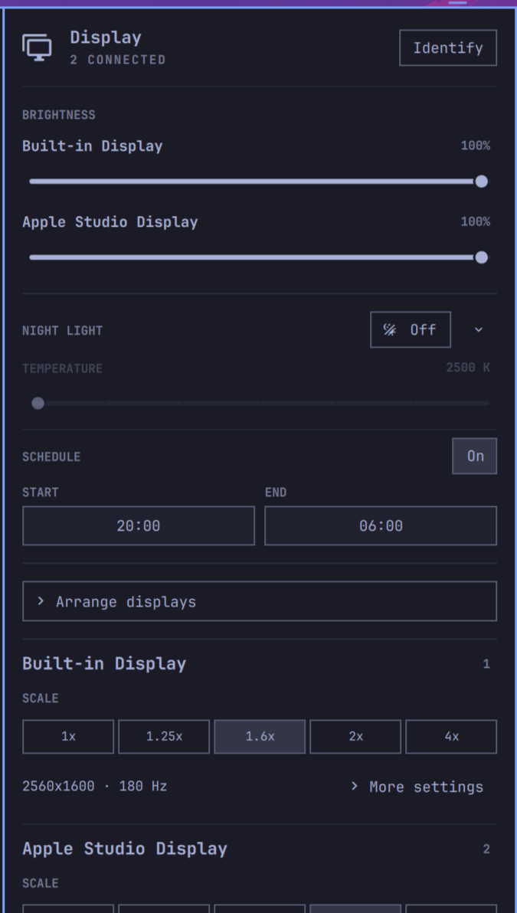

# Omarchy Display Settings

A native replacement for Omarchy's Display panel with visual monitor
arrangement, per-display settings, and safe dock profiles.

This plugin is based on Bryan Montgomery's MIT-licensed
[Omarchy Display Manager](https://github.com/Bmontythe3rd/omarchy-display-manager).
It integrates that project's arrangement and rollback model into the stock
Display-panel role, then adds per-display brightness and UI/text scale controls.



## Features

- Drag displays into position on a proportional desktop canvas with magnetic
  edge and alignment snapping.
- Select any display and independently set its resolution, refresh rate,
  orientation, compositor scale, mirroring, and connected state.
- Identify physical displays with numbered, named full-screen overlays.
- Apply panel changes immediately and expose an Undo button for restoring the
  preceding brightness value or verified layout.
- Remember one automatic layout for each exact connected-monitor topology and
  restore it after login or hotplug.
- Show brightness controls for every display supported by the internal,
  Apple-display, or DDC brightness backends.
- Put every connected display's brightness control at the top of a compact,
  native Omarchy-style panel.
- Move Night Light into the Display panel with an immediate on/off control and
  expandable 1600–5500 K color-temperature and daily schedule controls.
- Keep the visual arrangement canvas collapsed until needed, followed by a
  separate settings section for each connected display.
- Control UI and text size independently through each display's compositor
  scale using the same pill-button treatment as Omarchy's stock zoom controls.
- Use readable hardware names such as Apple Studio Display and Built-in
  Display throughout the panel.

## Safety and privacy

The plugin runs as the current user and requires no root access or additional
packages. It makes no network requests and stores only monitor fingerprints and
display settings under `~/.local/state/omarchy-display-settings/`.

Before applying a layout, the helper rejects configurations that:

- disable every display;
- contain duplicate or overlapping extended displays;
- use invalid modes, scales, transforms, or mirror targets; or
- omit required values.

Automatic application uses Lua-safe `hyprctl eval` calls. The helper reads the
live compositor state back after each modeset and restores the captured layout
if the hardware did not accept the requested settings. A transient systemd user
timer protects the operation while it is being verified; after success, the
snapshot becomes the state restored by **Undo**.

Night Light scheduling uses Hyprsunset's native time profiles and its user
systemd service. Enabling a schedule preserves the preceding configuration as
`~/.config/hypr/hyprsunset.conf.pre-display-settings`; disabling the schedule
restores that file. The chosen schedule is saved in the plugin's gitignored
`settings.json`, keeping machine preferences out of the plugin's source history.

The helper serializes display operations and pauses automatic profile matching
while a change is pending, so a shell rebuild or hotplug event cannot interrupt
an in-progress modeset.

After the plugin takes ownership of a verified profile, the helper replaces
Omarchy's exact stock catch-all monitor rule in `~/.config/hypr/monitors.lua`
with a managed block of explicit per-display rules and keeps a one-time
`monitors.lua.pre-display-settings` backup. Hyprland therefore loads the
verified positions and scales synchronously during configuration reloads. The
profile service also rechecks the saved layout after every reload and hotplug.

## Install

```bash
omarchy plugin add https://github.com/yeutterg/omarchy-display-settings --enable --yes
```

The plugin declares `omarchy.monitor` as its source, so enabling it replaces the
stock Display widget in place.

## Dependencies

Omarchy provides the required Quattro shell, Quickshell, Hyprland, Hyprsunset,
`jq`, `flock`, and systemd user services. Brightness controls appear only when
the relevant built-in, Apple-display, or DDC backend is available.

## Remove

If Night Light scheduling is enabled, turn it off in the panel first so the
plugin restores the Hyprsunset configuration it backed up. Then return to
Omarchy's stock Display widget:

```bash
omarchy plugin remove io.github.yeutterg.display-settings --yes
omarchy plugin enable omarchy.monitor
omarchy restart shell
```

Removing the plugin does not change the active monitor layout. Its one-time
`monitors.lua.pre-display-settings` backup and ordinary JSON topology profiles
remain available under the paths documented above and may be removed manually.

## Development

```bash
tests/run.sh
/usr/lib/qt6/bin/qmllint -I /usr/share/omarchy/shell \
  DisplayManager.qml ProfileService.qml IdentifyOverlay.qml
omarchy-plugin-validate .
```

The test suite mocks `hyprctl` and systemd, so it does not change the active
display layout. The original project and this derivative are licensed under
the [MIT License](LICENSE).
